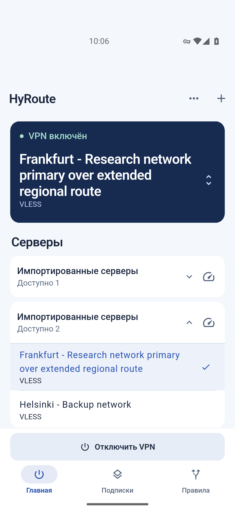
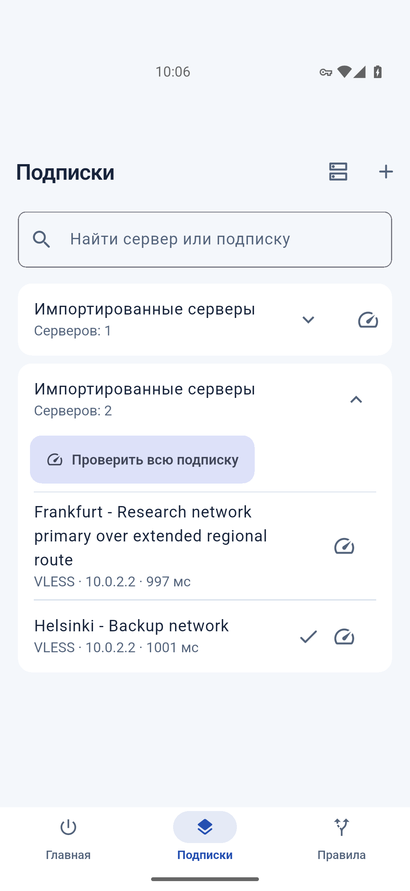
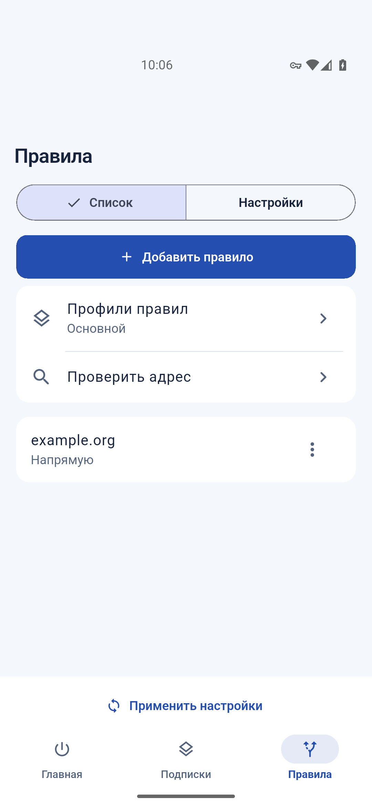
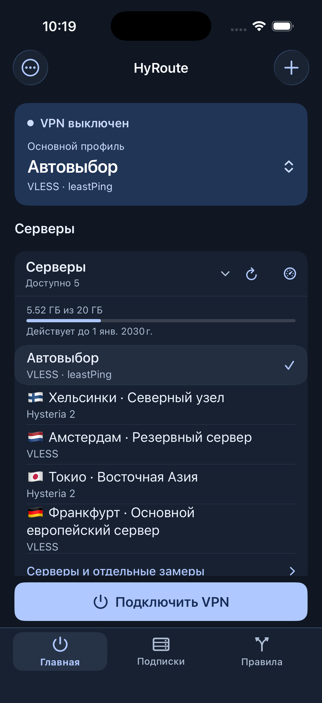
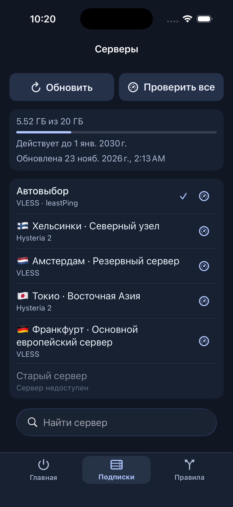
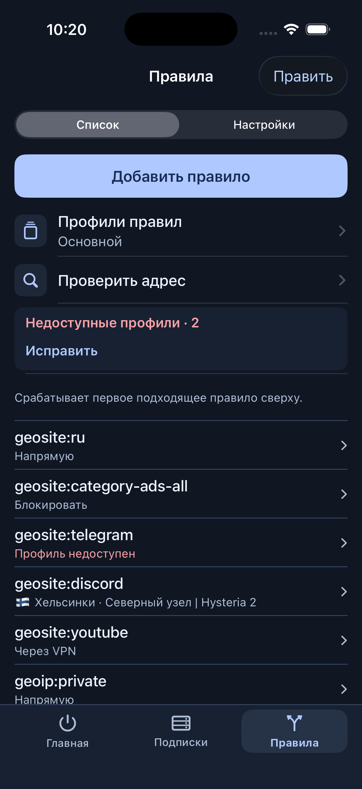

# HyRoute Mobile

VPN-клиент для Android и iOS с поддержкой Hysteria 2 и VLESS. Для подключения нужен собственный сервер или подписка VPN-провайдера.

В HyRoute можно выбрать сервер для всего трафика, отправить отдельные сайты или приложения по другим маршрутам и проверить, какое правило сработает для адреса.

## Возможности

### VPN и серверы

- **Подключение.** На главной видны состояние VPN и выбранный сервер. Здесь же можно выбрать другой профиль, включить или отключить VPN и применить изменения маршрутизации.
- **Импорт и обновление.** Добавляйте HTTPS-подписки или отдельные ссылки Hysteria 2 и VLESS. При обновлении подписки HyRoute сохраняет идентификаторы известных серверов, чтобы выбор профиля и привязки в правилах продолжали работать. При сбое доступен предыдущий список.
- **Группы серверов.** Объединяйте несколько основных серверов и при необходимости добавляйте резервный. Поддерживаются и профили автовыбора VLESS из подписок.
- **Замер задержки.** Проверяйте отдельный сервер, узлы группы или всю подписку. В списке видно время до ответа `204` на HTTPS-запрос через сервер или причину сбоя.

### Маршрутизация

- **Правила.** Направляйте трафик через VPN-профиль, напрямую или блокируйте его по домену, IP, порту и протоколу. Срабатывает первое подходящее правило сверху. Для остального трафика задаётся действие по умолчанию.
- **Профили правил.** Храните несколько наборов правил и переключайтесь между ними. Инструмент **Проверить адрес** показывает, какое правило и маршрут будут выбраны.
- **Цепочки VPN.** Задайте промежуточный профиль, через который HyRoute подключится к выходному серверу.
- **DNS и базы правил.** Настраивайте раздельный DNS, обновляйте или импортируйте базы GeoSite и GeoIP для правил по категориям.

### Диагностика и функции платформ

- **Журнал VPN** в меню главной показывает запуски, остановки, замеры и ошибки.
- **Android.** Привязывайте правила к приложениям и выбирайте, какие приложения используют VPN.
- **iOS.** Включайте автовосстановление VPN и блокировку соединений при его разрыве. Приложение «Команды» позволяет включать и выключать VPN, менять сервер и переподключаться. Запись в отдельный журнал подключений включается вручную.

## Скриншоты

Android Emulator и iPhone Simulator с тестовыми профилями. На снимках сборка **0.3.32**. [Исходники сборки](https://github.com/lardan099/HyRoute-Mobile/tree/codex/mobile-connection-redesign)

| Платформа | Главная | Подписка | Правила |
| --- | --- | --- | --- |
| Android | <a href="docs/screenshots/android-home.png"></a> | <a href="docs/screenshots/android-subscriptions.png"></a> | <a href="docs/screenshots/android-rules.png"></a> |
| iOS | <a href="docs/screenshots/ios-home.png"></a> | <a href="docs/screenshots/ios-subscription.png"></a> | <a href="docs/screenshots/ios-rules.png"></a> |

## Установка

Тестовые сборки **0.3.32** доступны в разделе **Artifacts** соответствующих прогонов GitHub Actions.

| Платформа | Файл | Где скачать |
| --- | --- | --- |
| Android 7.0+ (ARM64, x86-64) | `HyRoute-Android-debug-0.3.32.apk` | [Прогон Android](https://github.com/lardan099/HyRoute-Mobile/actions/runs/45370423267), артефакт `HyRoute-App-Android` |
| iOS 16+ | `HyRoute-iOS-unsigned-0.3.32.ipa` | [Прогон iOS](https://github.com/lardan099/HyRoute-Mobile/actions/runs/45371724423), артефакт `HyRoute-App-iOS` |

**Android.** Для обновления поверх установленного приложения с сохранением данных нужен APK с той же подписью. Debug-сертификат этой сборки отличается от сертификата APK 0.3.31.

**iOS.** IPA требует подписи перед установкой. Для работы VPN нужны права Network Extension (Packet Tunnel) и App Group `group.io.hyroute.mobile` у приложения HyRoute и расширения HyRouteTunnel. При обновлении сохраните идентификаторы и команду подписи, чтобы приложение сохранило доступ к данным в Keychain.

## Первый запуск

1. На главной нажмите **Добавить подписку** и вставьте HTTPS-ссылку на подписку или конфиг Hysteria 2 либо VLESS. Если приложение запрашивает доступ к буферу, подтвердите вставку или введите ссылку вручную.
2. Выберите сервер на главной и нажмите **Подключить VPN**. При первом подключении подтвердите системный запрос на настройку VPN.
3. Если VPN уже включён, после смены профиля или правки маршрутизации нажмите **Применить** на iOS или **Применить настройки** на Android.

## Сборка

Ручной workflow [Mobile Go bindings](https://github.com/lardan099/HyRoute-Mobile/actions/workflows/mobile-bindings.yml) собирает Go-привязки и проверяет ядро. Выберите ветку с нужной версией, установите `build_apps=true` и укажите `Android`, `iOS` или `Both` в поле `platform`. Сборки выбранных платформ появятся в **Artifacts**. Прогон iOS также публикует снимки iPhone Simulator. Конфигурация хранится в [`mobile-bindings.yml`](.github/workflows/mobile-bindings.yml).

### Android

Flutter-клиент находится в [`app/`](app). Для APK с нативным ядром положите `HyRouteCore.aar` из артефакта `HyRouteCore-Android` в `dist/`. Используйте привязки той же ревизии, Flutter 3.44.0 и установленный Android SDK.

```sh
cd app
flutter pub get --enforce-lockfile
flutter build apk --debug --no-pub --target-platform android-arm64,android-x64
```

### iOS

На macOS положите `HyRouteCore.xcframework` той же ревизии из артефакта `HyRouteCore-iOS` в `dist/`. Откройте [`app/ios/HyRoute.xcodeproj`](app/ios/HyRoute.xcodeproj) в Xcode и выберите схему **HyRoute**. Клиент использует SwiftUI, туннель запускается через Packet Tunnel.

## Проверка

Проверки ядра запускаются из корня репозитория. Требуется Go 1.27.

```sh
go test ./...
go vet ./...
```

Flutter-тесты и статический анализ работают без нативных привязок.

```sh
cd app
flutter pub get --enforce-lockfile
dart analyze
flutter test --no-pub
```

Для веб-предпросмотра интерфейса запустите `flutter run -d chrome` в `app/`.

iOS workflow запускает проверки совместимости хранилища и XCTest на обычном и компактном iPhone Simulator.

## Лицензия и безопасность

Код HyRoute Mobile распространяется под [MIT](LICENSE). Встроенный [Xray-core v26.10.31](https://github.com/XTLS/Xray-core/tree/a4a3dff5b20c) распространяется под [MPL 2.0](https://github.com/XTLS/Xray-core/blob/a4a3dff5b20c/LICENSE). Принципы хранения данных и работы VPN описаны в [SECURITY.md](SECURITY.md).
